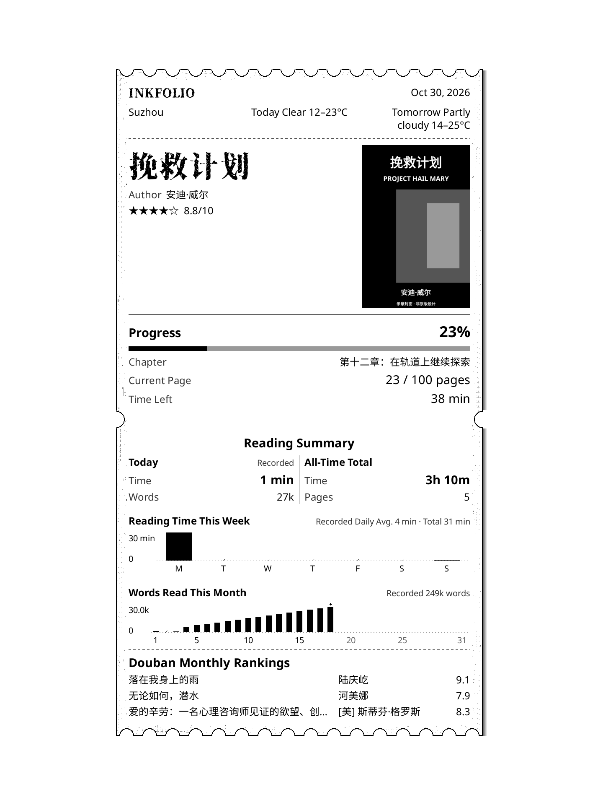
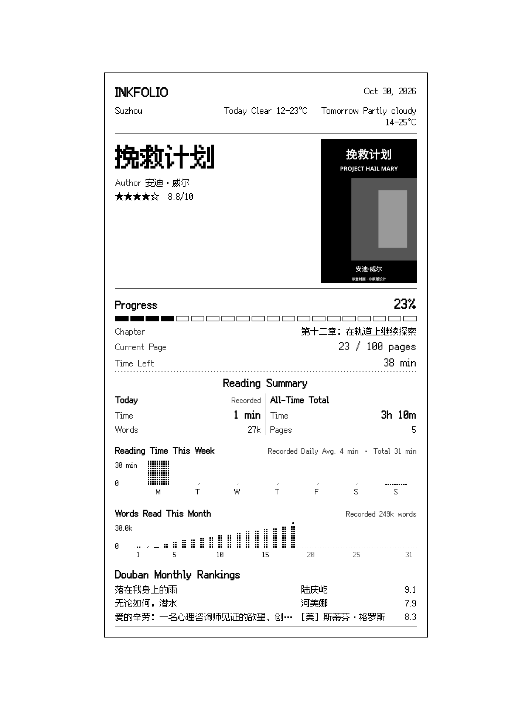
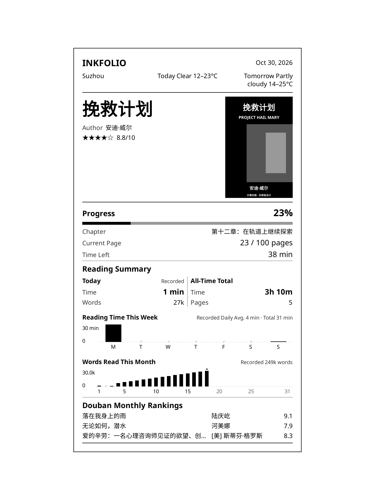

# InkFolio

**v1.3.0 · October 30, 2026** · [简体中文](README.md)

A lock-screen plugin for KOReader. Reading cards show book covers, Douban ratings, reading progress, time, pages, and word counts, with reading goals, monthly rankings, local weather, and screenshots.

[Download the complete installation package](https://github.com/zacharykim88/Inkfolio/releases/download/v1.3.0/InkFolio-v1.3.0.zip) · [Release notes](CHANGELOG.en.md)

## Features

- **Four styles:** Receipt, Pixel, Modern, and Cover, with shared reading data, live previews, and adjustable sizes and backgrounds.
- **Cover cards:** a reading card over the book cover. Choose Auto, White, or Dark Gray for the card background. Auto adapts to the surrounding image. Covers keep their original proportions; uncovered areas can be black or white.
- **Reading statistics:** progress, chapters, pages, words, and time. Combine up to two summaries and two weekly or monthly charts.
- **Reading goals:** daily, weekly, or monthly targets for time or words.
- **Douban:** ratings, match review, custom searches, source information, and monthly rankings with categories and offline rotation.
- **Weather:** forecasts for today and tomorrow, with text or condition icons. The source is China's National Meteorological Center; locations are limited to those listed in the settings. Temperatures use Celsius.
- **Language and tools:** Simplified Chinese and English, gesture actions, screenshots, and redacted diagnostics.

## Style previews

These are software-rendered previews using KOReader's native widgets, example data, and an illustrative cover, **not screenshots from a real device**. Visible content depends on your selections.

| Receipt | Pixel |
| --- | --- |
|  |  |
| **Modern** | **Cover** |
|  |  |

## Compatibility

You need a working KOReader installation. This patch cannot be installed directly into an e-reader's original system.

| Platform | Scope |
| --- | --- |
| Kobo Sage and Kindle | Tested on real devices. Sleep screens depend on device and KOReader platform support. |
| PocketBook | Requires KOReader; sleep screens depend on platform support. Not tested on real devices. |
| Android phones and e-readers | Previews and screenshots may work with [official KOReader builds](https://github.com/koreader/koreader/releases) that support user patches. Cannot replace the system lock screen. Not tested on real devices. |
| F-Droid builds | Do not support the required user patches. |

Enable KOReader's built-in Reading Statistics plugin for time and page statistics. Word counts require extractable book text; scanned pages without a text layer are not supported.

## Install or upgrade

1. Download **InkFolio-v1.3.0.zip** and extract it. GitHub's automatically generated Source code archive is not the complete installation package.
2. Fully exit KOReader. Place `2-inkfolio.lua` in its `patches/` directory, creating the directory if necessary.
3. Merge the included `fonts/` into KOReader's `fonts/`, keeping existing fonts.
4. Restart KOReader. Check **Tools → InkFolio → About** for **v1.3.0**.

Kobo's data directory is usually `.adds/koreader`; Kindle's is usually `koreader`. Android uses the actual KOReader data directory and requires storage permissions.

When upgrading, back up your patch outside `patches/`, replace the existing patch, and keep only one InkFolio patch. Remove duplicate copies with suffixes such as `(2)` or `(3)`. Keep `settings.reader.lua`, `settings/read_receipt_v2_db.lua`, existing `settings/read_receipt_v2_words.lua`, and KOReader's statistics database. Your settings, caches, and reading records are retained.

**v1.0.0 users only:** remove `2-book-receipt-shortcut-and-lockscreen.lua` before installing the new file. Existing Paper selections from development builds migrate to Cover; other style settings are kept.

## Settings

- **Language:** changes InkFolio only. Book content, your own text, and KOReader's global language stay unchanged. Shared keyboards and folder pickers follow KOReader's language.
- **Content → Weather & Date:** choose today's weather, tomorrow's weather, date, location, and text or icons. Cover shows one forecast at the bottom of the card; other styles can show both at the top.
- **Content → Reading Summary:** select up to two summaries and two charts. Period summaries offer Time + Words or Time + Pages; all-time summaries keep time and pages. Items not displayed in Cover are disabled while preserving their selections for other styles.
- **Reading Goals:** choose a period and metric. English word targets are entered in whole thousands; Chinese uses ten-thousands with one decimal place. Switching languages does not change the stored target.
- **Appearance:** switch styles and adjust the preview. Tap the preview for full screen, then tap to return. Save applies changes; Cancel or Back discards the draft.
- **Online Services:** update information, review uncertain matches, and inspect sources. Complete book information is reused.
- **Developer Options:** action recording, update popups, and diagnostics. Reports should include device model, KOReader and InkFolio versions, reproduction steps, and screenshots. Do not publish unredacted settings, personal data, or book text.

## Updates and statistics

Weather is due after six hours and checked again on a new day or after changing locations. If a refresh fails, valid forecasts already fetched that day for the same location stay visible. Update Status still records the latest attempt and failure. Update Information can refresh manually; weather is not fetched when both days are off.

Failed automatic book updates wait at least 30 minutes, with up to three attempts per book per day. Canceling pauses only that module until the next wake. Opening a book checks that book; entering or refreshing the library checks the library. No fixed 45-second polling or periodic library scans are used. InkFolio does not turn on Wi-Fi automatically. Rankings rotate offline at actual sleep screens.

Each Chinese character counts as one word, while English is counted by word. Punctuation and whitespace are excluded, and the same text is counted once per wake session. Counts reflect text viewed, not confirmation that every word was read. Period word records begin when InkFolio starts recording; earlier missing dates are not filled in. Estimated book progress does not contribute to period word totals or goals.

Time and pages come from KOReader's statistics and can include retained history. English weekly charts start on Sunday; Chinese charts start on Monday. Weekly summaries and goals start on Monday in both languages. See About Reading Stats for details.

## Fonts, credits, and license

The complete package includes Xiangcui Typewriter W40, Fusion Pixel, and their original license notices. Modern and Cover use KOReader's built-in fonts; English Cover titles use Noto Serif Italic. See [FONT-SOURCES.md](FONT-SOURCES.md).

Design and development: zacharykim88. Development assistance: OpenAI Codex.

Credits: [Estela-Zelin84/KOReader_Book-Receipt](https://github.com/Estela-Zelin84/KOReader_Book-Receipt), u/hundredpercentcocoa, and [omer-faruq/koreader-user-patches](https://github.com/omer-faruq/koreader-user-patches).

Code and original weather artwork: GPL-3.0; see [COPYING](COPYING). Fonts retain their own licenses. See [VALIDATION.md](VALIDATION.md) for validation scope.
