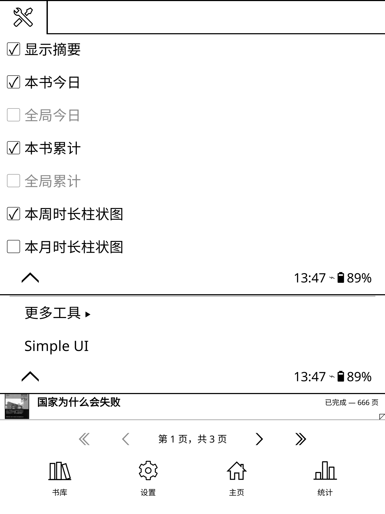
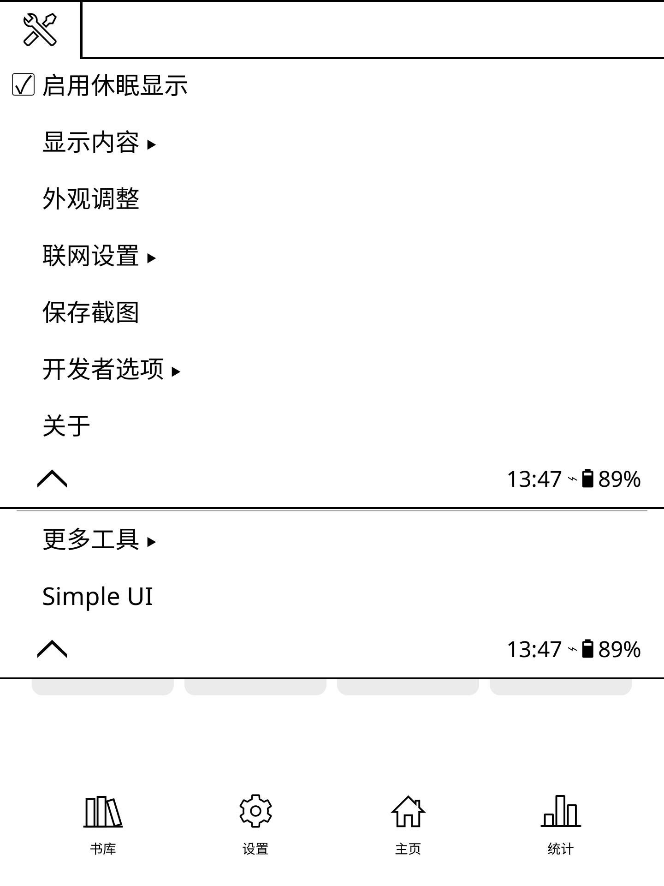
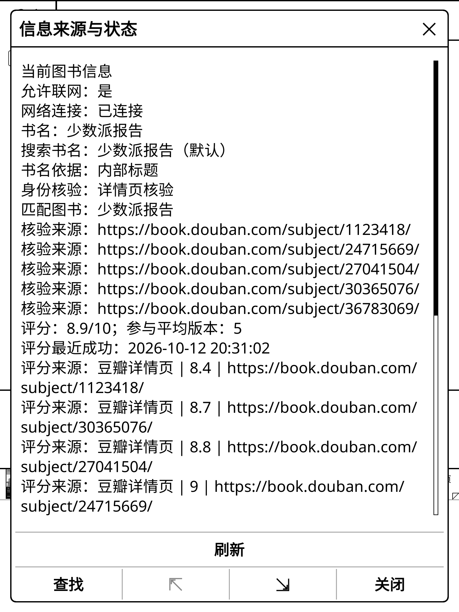
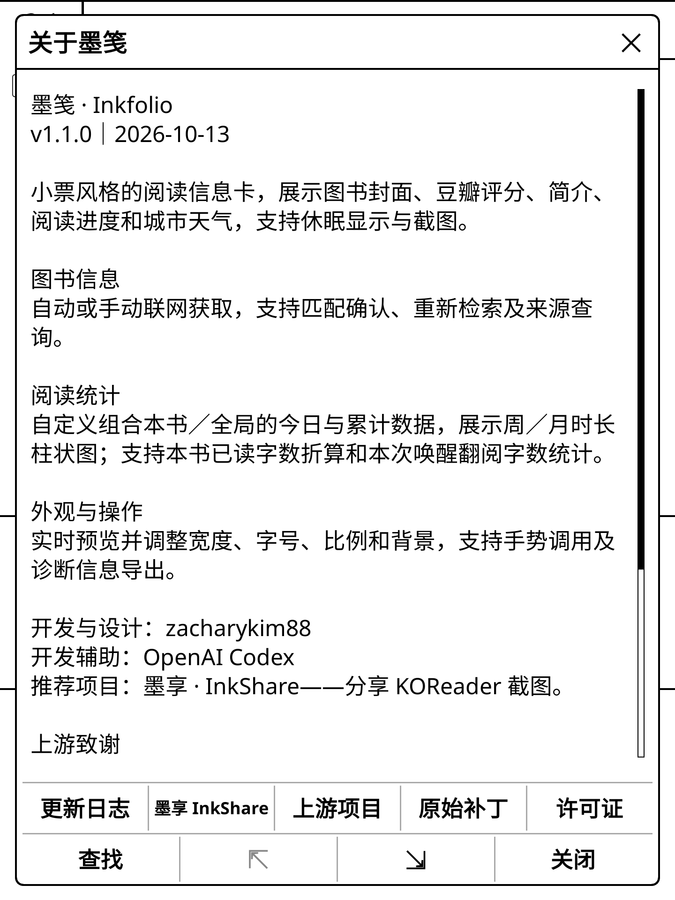
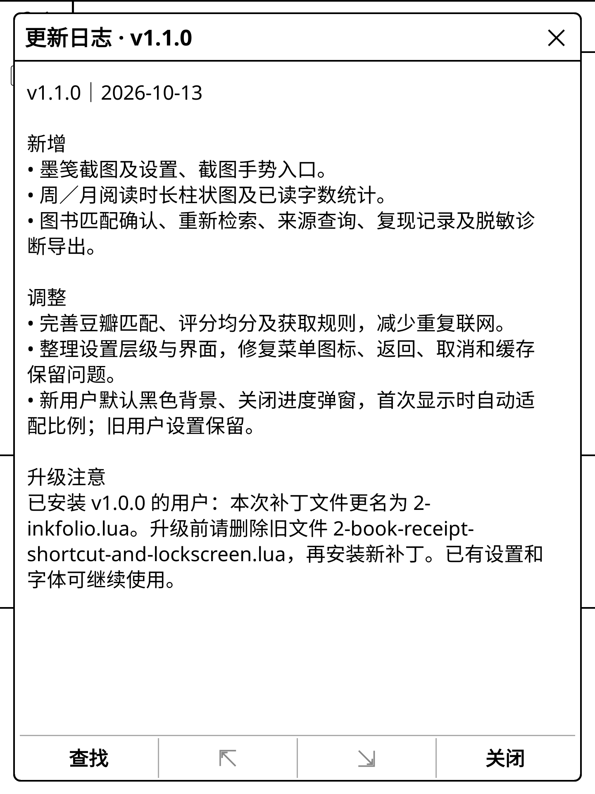

# 墨笺 · Inkfolio

v1.1.0 · 2026-10-13

小票风格的 KOReader 阅读信息卡：展示封面、豆瓣评分、简介、阅读进度、阅读统计和城市天气，支持休眠显示与截图。

- 图书信息自动／手动联网获取，支持候选确认、重新检索、版本／分册均分及来源查询。
- 阅读统计可组合本书／全局的今日与累计数据，额外选择本周或本月全局阅读时长柱状图。
- 本书已读字数按当前进度折算；唤醒已读字数按此次唤醒后实际翻阅内容去重统计。中文每字、英文每单词计一字，不计标点和空白；可读取正文的格式支持程度以设备与文档为准。
- 外观实时预览，可调整宽度、字号、比例和背景；可绑定设置、预览、截图手势，导出脱敏诊断信息。

## 下载

[下载 v1.1.0 完整安装包](https://github.com/zacharykim88/Inkfolio/releases/download/v1.1.0/Inkfolio-v1.1.0.zip)（含补丁、字体和授权文件）。

## 设备实际运行截图

以下图片由用户在 **Kobo Sage／KOReader v2026.07.2** 上于 **2026-10-13** 截取，分辨率 **1440×1920**。菜单与弹窗通过 **墨点截屏** 获取，完整墨笺图来自墨笺截图。图片保留原始画面。

**拍摄版本：前五张来自 v1.1.0 的默认设置与诊断开发修订；关于、更新日志两张来自最终完整包。**以下是设备内实际运行截图，不是设备实拍照片或软件模拟图。截图里的阅读数据和显示选项来自当时设置；简介区域显示该书现有元数据。

### 1. 墨笺完整界面

展示封面、豆瓣评分、天气、阅读进度、已读字数、阅读摘要及本周时长柱状图。

### 2. 外观实时预览

调整宽度、字号、整体比例和背景，并同步查看预览。

### 3. 阅读摘要组合

自定义本书／全局的今日与累计数据组合，可额外选择周／月时长柱状图。

### 4. 设置主菜单

集中管理显示内容、外观、联网、截图及开发者选项。

### 5. 信息来源与状态

查看匹配条目、豆瓣评分来源、参与版本及最近获取记录。

### 6. 关于墨笺

最终包的项目介绍、版本与开发信息；截图展示页面可见部分。

### 7. 更新日志

展示 v1.1.0 的新增功能、调整和面向 v1.0.0 用户的升级注意。

## 历史效果预览 · v1.0.0

### v1.0.0 · Kobo 设备实拍图

下图为用户提供的 Kobo 设备实拍照片，展示墨笺在真实墨水屏上的显示效果。

### 软件渲染预览说明

下面三张图使用 **v1.0.0 正式版绘制代码和随包字体**，在 **KOReader v2026.07.1 Linux 环境**中实际渲染，分辨率为 **1440×1920**。天气、统计、评分、封面及阅读背景均为示例数据；图片为软件渲染预览，未经实物墨水屏拍摄。

### 白色背景 · 待读

### 黑色背景 · 在读

### 透明背景 · 读完

透明背景示例保留了一段示例阅读画面。

## 首次安装

1. 完全退出 KOReader，备份现有设置。
2. 将 `2-inkfolio.lua` 放入 KOReader 数据目录下的 `patches/`，没有该目录则创建。
3. 将本包 `fonts/` 合并至 KOReader 的 `fonts/`，保留原有字体。
4. 重新启动 KOReader，在 **工具 → 墨笺 → 关于** 确认版本为 **v1.1.0**。
5. 在墨笺设置中选择书库目录、天气城市及显示内容；启用“休眠显示”后，在支持的平台使用墨笺休眠界面。

数据目录因平台而异：Kobo 通常位于 `.adds/koreader`，Kindle 通常位于 `koreader`；Android 使用其 KOReader 数据目录，需要可用的存储权限。以设备实际安装位置为准。

## 已安装 v1.0.0 的用户升级

1. 完全退出 KOReader。备份原补丁及 `settings/read_receipt_v2_db.lua`；补丁备份放在 `patches/` 外。
2. **删除旧的 `2-book-receipt-shortcut-and-lockscreen.lua`，以及其他重复的墨笺补丁。** 不要只把新文件添加进去；同一目录只能保留一份墨笺补丁。
3. 安装 `2-inkfolio.lua`。已有字体可继续使用，新设备或缺少字体时合并本包 `fonts/`。
4. 保留现有设置和缓存，不要清空数据库；重新启动并核对版本。

## 新用户默认设置

默认黑色背景，进度弹窗和复现记录关闭。首次取得图书数据时，根据实际屏幕分辨率和小票布局测量并保存合适比例；已有用户的设置保留。首次适配后增加模块或换成长内容，可能需要在外观中手动调整比例。

## 常用设置

- **工具 → 墨笺**：显示内容、外观、联网设置、截图、开发者选项、关于。
- **阅读摘要**：最多组合两项本书／全局的今日／累计数据，可另外选择一个周／月柱状图；依赖 KOReader 阅读统计插件。
- **阅读进度**：章节、已读页数固定显示，其他项目最多选择两项。
- **联网设置 → 更新信息**：阅读界面只刷新当前书和一次天气；主页扫描书库，跳过已完成、待确认和暂不采用的书籍。
- 自动常规获取每日最多3轮，新加入的文件路径不受此限制。取消后暂停本次唤醒的自动任务，下次唤醒恢复；手动仍可用。
- 开发者选项可开启进度弹窗。进度弹窗中的“忽略”关闭弹窗并在后台继续，“取消”停止本轮任务。
- 没有任何可用简介时隐藏豆瓣二维码。评分均分明确标注参与类型，具体来源可在信息状态中查看。
- 设置、预览、截图可通过 KOReader 的手势／动作配置绑定；截图保存至 KOReader 配置的截屏目录。

## 兼容性与反馈

用户在 Kobo Sage／KOReader 2026.07.2 配合 SimpleUI 的环境中实机测试，已完成本完整包实机验收，反馈正常，未提供逐项覆盖记录。其他设备尚未实机验证。

休眠显示依赖平台能力；Android 不替换系统锁屏，F-Droid 版不执行本用户补丁。书籍正文、统计插件、网络服务和页面格式都可能影响对应功能，不保证所有书籍自动匹配成功。

遇到图书匹配问题，可确认候选或输入书名、作者重新检索；排查时可先开启开发者选项中的复现记录，重现问题后查看诊断导出预览，再复制或保存脱敏诊断信息。记录包含设备与设置状态、近期操作及安全异常位置，不采集CPU、内存或耗电。不要公开未经脱敏的设置数据库、日志、个人文字或书籍正文。

## 字体、许可与致谢

仓库源码不含香萃字体文件，请从完整安装包取得。完整包包含香萃打字机体 W40 和 Cinzel Decorative Bold；字体采用 SIL OFL 1.1，来源、版权及许可证见 `FONT-SOURCES.md` 和 `fonts/` 内文件。代码采用 GPL-3.0，许可证见 `COPYING`；软件按现状提供，不作担保。

开发与设计：zacharykim88。开发辅助：OpenAI Codex。

上游致谢：[Estela-Zelin84/KOReader_Book-Receipt](https://github.com/Estela-Zelin84/KOReader_Book-Receipt)、Reddit 用户 u/hundredpercentcocoa，以及 [omer-faruq/koreader-user-patches](https://github.com/omer-faruq/koreader-user-patches)。保留原有版权声明。

推荐：[墨享 · InkShare](https://github.com/zacharykim88/inkshare.koplugin)，用于分享 KOReader 截图。

更新内容见 `CHANGELOG.md`，验证范围见 `VALIDATION.md`。
