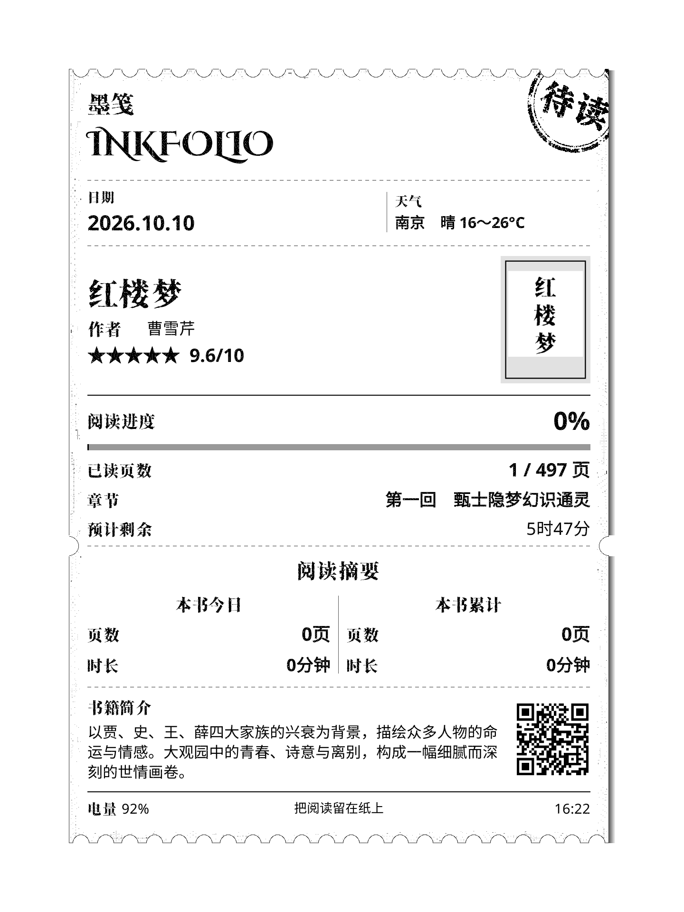
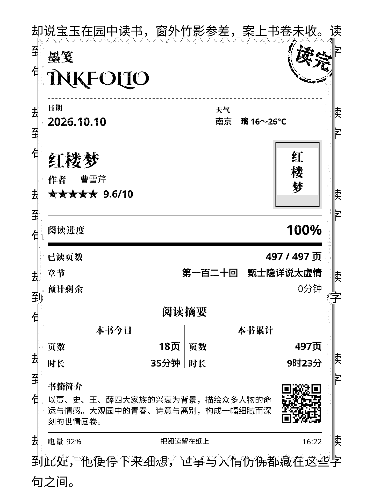

# 墨笺 · Inkfolio

版本：**v1.0.0** · 2026-10-10  
二次开发与设计：**zacharykim88** · 开发辅助：OpenAI Codex

这是 KOReader 的 Lua 用户补丁，将当前书籍信息、阅读进度、阅读摘要和天气制作成电影票根风格的小票，可用于阅读中的预览及受支持设备的休眠壁纸。

## 初版功能

- 电影票根风格：墨笺 / Inkfolio 标题、书籍封面、评分、三行简介、二维码、阅读状态邮戳、右侧阴影。
- 阅读界面与主页休眠显示；主页使用最近阅读书籍的记录。
- 本书今日、本书累计、全局今日、全局累计四种阅读摘要，最多选择两项；支持页数、时长和阅读进度显示。
- 异步获取图书信息与中国气象局天气；显示城市、天气状态和温度，支持真实任务进度、后台继续和取消。
- 可编辑底部居中文字；支持白色、黑色、透明背景。
- 外观实时缩小预览，同步调整宽度、字号、整体比例和背景，保存后应用。
- 原生菜单、按设备能力启用休眠显示、可选书库目录、关于与开源来源说明。

## 效果预览

### Kobo 设备实拍图

下图为用户提供的 Kobo 设备实拍照片，展示墨笺在真实墨水屏上的显示效果。

### 软件渲染预览说明

下面三张图使用 **v1.0.0 正式版绘制代码和随包字体**，在 **KOReader v2026.07.1 Linux 环境**中实际渲染，分辨率为 **1440×1920**。天气、统计、评分、封面及阅读背景均为示例数据；图片为软件渲染预览，未经实物墨水屏拍摄。

### 白色背景 · 待读

### 黑色背景 · 在读

### 透明背景 · 读完

透明背景示例保留了一段示例阅读画面。

## 兼容性状态

本版完成了代码适配和离线模拟检查，**没有完成所有设备的真机验证，也不承诺支持所有 KOReader 设备或版本**。此前版本由用户在 Kobo Sage / KOReader 2026.07.2 + SimpleUI 上测试；实时外观编辑器及最终修改仍需真机验证。

| 平台 | 本版处理 | 真机状态 |
| --- | --- | --- |
| Kobo、Kindle、PocketBook、reMarkable 等阅读器 | 使用 KOReader 设备能力接口决定是否启用休眠壁纸，读取设备原生书库默认目录 | 除此前 Kobo Sage 测试外，其他设备待反馈 |
| Android | 提供小票预览与设置，使用系统网络及可读取的书库目录；不替换 Android 系统锁屏 | 待反馈 |
| Linux 等桌面环境 | 提供小票预览与设置；休眠壁纸取决于 KOReader 报告的设备能力 | 待反馈 |

Android 的 F-Droid 版 KOReader 不执行用户补丁，不能通过安装本 Lua 文件启用本项目。其他 Android 版本仍需确认有存储权限。依据：[KOReader 用户补丁加载器](https://github.com/koreader/koreader/blob/master/frontend/userpatch.lua)。

联网获取依赖 KOReader 的子进程与 HTTPS 接口、网站可访问性及页面格式；接口不可用或请求失败时报告错误。阅读摘要依赖 KOReader 阅读统计插件及其数据库；缺少统计记录时不能凭空产生累计数据。

## 下载

[下载 v1.0.0 完整安装包](https://github.com/zacharykim88/Inkfolio/releases/download/v1.0.0/Inkfolio-v1.0.0.zip)（含补丁、两款字体与授权文件）。

版本发布页：[Releases](https://github.com/zacharykim88/Inkfolio/releases)。安装请使用上方完整包；仓库中香萃字体保存在完整包内，直接下载源码时请另行取得完整包中的字体。

## 安装与升级

1. 备份设备中旧版同名 Lua 补丁。升级时仅保留一份有效补丁。
2. 将 `2-book-receipt-shortcut-and-lockscreen.lua` 放入 **KOReader 数据目录下的 `patches/`**，保留文件名。不要放入 `plugins/`。
3. 将包内 `fonts/` 的内容合并到 **KOReader 数据目录下的 `fonts/`**，保留文件名和子目录；已有字体可先备份。字体和对应许可证已随包提供：
   - `fonts/CinzelDecorative-Bold.ttf`
   - `fonts/Xiangcui-Dazijiti-main/香萃打字机体 W40.ttf`
4. 完全退出并重新启动 KOReader。字体缺失时小票会明确提示所需文件。
5. 在原生主菜单找到「墨笺」。首次使用建议在「信息获取 → 书库目录」选择实际存放图书的文件夹，并设置天气城市。
6. 安装后打开一本书并返回主页一次，建立最近阅读记录。阅读界面休眠显示当前书籍，主页休眠显示最近阅读的书籍；记录在重启后保留，天气、电量、时间和阅读摘要在显示时读取。
7. 通过「墨笺 → 外观」查看并调整实时预览。支持休眠壁纸的平台可勾选「休眠显示」；原有休眠壁纸菜单入口也继续保留。

数据目录由 KOReader 的 `DataStorage` 接口决定，不能把 Kobo 的安装路径直接套用到所有设备。原有 `settings/read_receipt_v2_db.lua` 缓存和 `read_receipt_v2_` 设置继续沿用，无需清空。

书库目录仅选择一个；本版没有合并多个存储根目录。切换目录后，以新目录的首次完整扫描建立基线，原有文件不会全部被误认为新加入的书籍。目录无法完整读取或超过24层时会停止该次扫描并保留原有文件列表；修复目录权限或选择其他书库目录后可点击「立即更新」重试。

## 信息获取规则

- 允许联网且网络可用时，自动获取未完成缓存的图书信息；常规自动任务每天最多 5 轮。
- 首次扫描建立文件列表基线。之后新发现的图书可触发额外自动任务，不占用上述 5 轮；失败后的同日重试限制仍保留。
- 手动更新不限上述轮数，已完成的缓存继续复用。
- 天气随图书信息任务刷新；切换城市后刷新一次，离线时等待后续联网。
- 获取进度弹窗可在「信息获取」开关。忽略关闭弹窗并继续后台任务；取消停止当前联网获取。

## 验证与反馈

本版通过 **154 项源码语法、回归、异步任务、设置、跨设备接口及排版模型检查**。排版模型覆盖不同尺寸、横竖屏及 DPI，不能替代真实 KOReader 字体渲染、休眠流程、存储权限和网络测试。

反馈时提供：设备型号、系统和 KOReader 版本、是否使用 SimpleUI、屏幕方向、复现步骤、截图及相关日志。请检查日志并移除不愿公开的个人路径或书籍信息。

项目地址：https://github.com/zacharykim88/Inkfolio

问题与适配反馈：https://github.com/zacharykim88/Inkfolio/issues

## 来源与许可证

本项目基于 [Estela-Zelin84/KOReader_Book-Receipt](https://github.com/Estela-Zelin84/KOReader_Book-Receipt) 二次开发。上游注明原创代码来自 Reddit 用户 **u/hundredpercentcocoa**，原始补丁收录于 [omer-faruq/koreader-user-patches](https://github.com/omer-faruq/koreader-user-patches)。感谢原作者与贡献者。

修改内容包括票根视觉、异步图书信息获取、天气、阅读摘要、设置及设备适配。代码按 **GNU GPL v3.0** 提供；完整许可证见 `COPYING`。软件按现状提供，不作担保。

此完整包附带官方来源的 Cinzel Decorative Bold 和香萃打字机体 W40，字体文件未作修改。字体采用 SIL OFL 1.1，与 Lua 代码的 GPL 许可证分别适用。字体来源、作者说明、原始许可证及下载链接见 `FONT-SOURCES.md`；字体授权文件随各自字体放置。KOReader 本身由其上游项目维护。

上游许可证：[LICENSE](https://github.com/Estela-Zelin84/KOReader_Book-Receipt/blob/main/LICENSE)。

## 设置交互

天气城市为单选，可清除选择。关闭联网或已有获取任务时，“立即更新”灰显。关闭“休眠显示”后保持屏幕原样。外观为实时编辑页面：按设备原始分辨率生成墨笺，再等比例缩小预览。下方四排按钮调整宽度（55～90%，每步1%）、字号（80～120%，每步5%）、比例（50～150%，每步5%）和白色、黑色、透明背景。连续操作停下0.5秒后合并更新预览；保存才应用，取消保留原设置。超出屏幕或字体无法加载时禁止保存。透明预览使用进入编辑前的阅读界面或主页画面；旋转屏幕或休眠会取消编辑。
