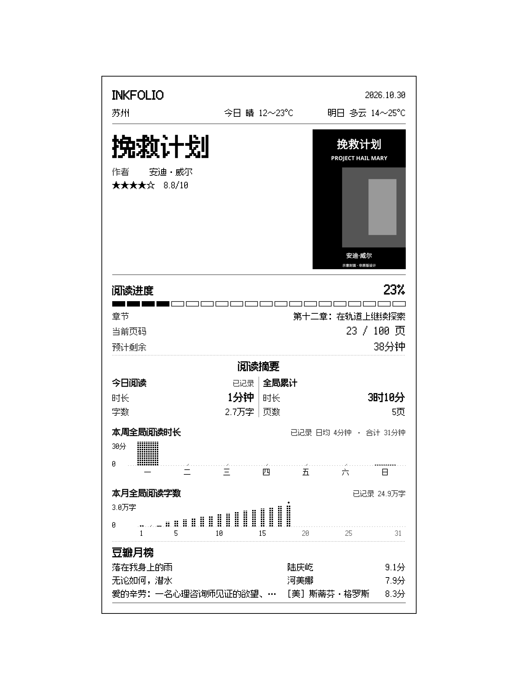
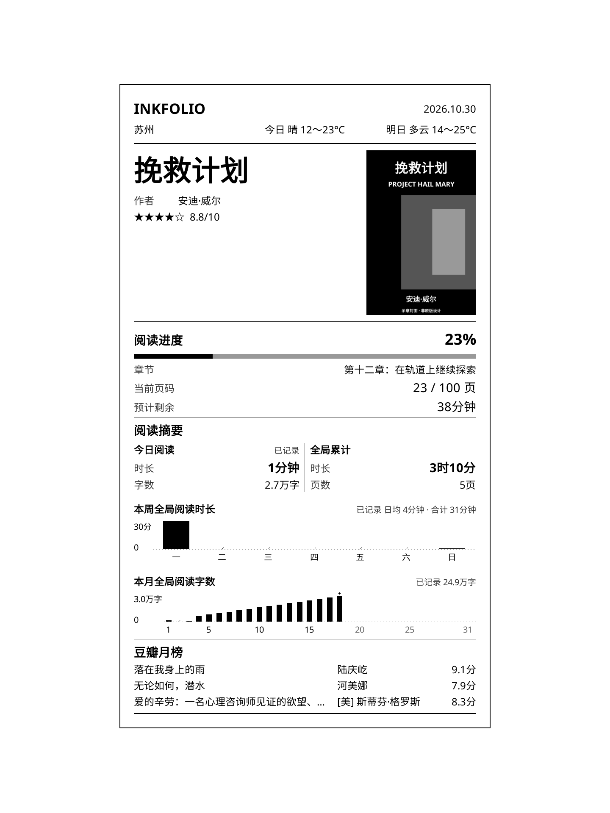

# InkFolio

**v1.3.0 · 2026-10-30** · [English](README.en-US.md)

为 KOReader 设计的锁屏插件，以阅读信息卡展示图书封面、豆瓣评分、阅读进度、时长、页数和字数，支持阅读目标、豆瓣月榜、城市天气与截图。

[下载完整安装包](https://github.com/zacharykim88/Inkfolio/releases/download/v1.3.0/InkFolio-v1.3.0.zip) · [更新日志](CHANGELOG.md)

## 主要功能

- **四种 UI皮肤**：小票、像素、现代、封面。共用阅读数据与设置，支持外观实时预览、全屏查看和尺寸调整。
- **封面信息卡**：在图书封面上展示阅读信息，卡片底色可选自动、白色或深灰；自动根据卡片周围的画面明暗调整配色。封面保持原比例，不拉伸，未铺满区域可选黑色／白色。
- **阅读进度与统计**：当前图书的进度、章节、页码和字数；自定义组合今日、本周、本月及累计数据，数字摘要与周／月趋势图各最多两项。
- **阅读目标**：按日、周、月设置时长或字数目标，查看完成比例及当前量／目标量。
- **豆瓣信息**：自动／手动获取评分，支持匹配确认、重新检索、来源查询；豆瓣月榜支持分类与离线轮换。
- **城市天气**：支持今日／明日预报，可选文字或状态图标。天气来自中国气象局中央气象台，支持设置列表内的城市，温度使用摄氏度。
- **语言与操作**：简体中文／英语切换、手势调用、截图与脱敏诊断导出。

## 四种皮肤预览

以下为本版本使用 KOReader 原生组件生成的软件渲染预览，采用示例数据和示意封面，**不是实机截图**。图片中的内容随用户实际选择而变化。

| 小票 | 像素 |
| --- | --- |
|  |  |
| **现代** | **封面** |
|  |  |

## 安装前：兼容性

需先安装并正常运行 KOReader，不能将本补丁直接安装到阅读器原生系统。

| 设备／安装版本 | 使用范围 |
| --- | --- |
| Kobo Sage、Kindle | 已通过实机验证；休眠显示依赖设备与 KOReader 的平台支持。 |
| PocketBook | 需先安装 KOReader，休眠显示取决于设备支持，尚未经实机验证。 |
| Android 手机及安卓电纸书 | 使用支持用户补丁的 [KOReader 官方 GitHub 安装包](https://github.com/koreader/koreader/releases)，可尝试预览与截图；无法替换系统锁屏，尚未经实机验证。 |
| F-Droid 版 KOReader | 不支持本项目所需的用户补丁，无法使用。 |

阅读统计需启用 KOReader 内置“阅读统计”插件；字数统计需要可提取的图书正文，不适用于没有文本层的扫描页。联网功能还受网络与信息来源服务可用性影响。

## 首次安装

1. 下载 **InkFolio-v1.3.0.zip** 并解压，不要使用 GitHub 自动生成的 Source code 包代替完整安装包。
2. 完全退出 KOReader，将 `2-inkfolio.lua` 放入 KOReader 数据目录下的 `patches/`，没有该目录则创建。
3. 将随包 `fonts/` 合并至 KOReader 的同名目录，保留原有字体，不要替换整个目录。
4. 重新启动 KOReader，在 **工具 → InkFolio → 关于** 核对 **v1.3.0**。
5. 按需选择书库目录、显示内容、天气城市、阅读目标和 UI皮肤；支持的平台可启用休眠显示。

Kobo 数据目录通常为 `.adds/koreader`，Kindle 通常为 `koreader`；Android 使用实际 KOReader 数据目录，并需相应存储权限。

## 已安装用户升级

完全退出 KOReader，备份原补丁及设置；补丁备份放在 `patches/` 之外。覆盖 `2-inkfolio.lua`，合并随包字体，再完全重启。同一功能只保留一份补丁；若旧文件带 `(2)`、`(3)` 等后缀，也需移除重复文件。

保留 `settings.reader.lua`、`settings/read_receipt_v2_db.lua`、已有的 `settings/read_receipt_v2_words.lua` 及 KOReader 阅读统计数据库，不要清空设置、缓存或阅读记录。

**仅 v1.0.0 用户**：安装前先删除旧文件 `2-book-receipt-shortcut-and-lockscreen.lua`。升级期间移除过的纸上皮肤会迁移为封面，其他皮肤设置继续保留。

## 常用设置

- **语言**：切换简体中文／English，只改变 InkFolio 界面；不改变书籍内容、用户文字或 KOReader 全局语言。原生键盘和文件夹选择器继续使用 KOReader 的语言。
- **显示内容 → 天气与日期**：分别选择今日、明日、日期、城市和天气文字／图标。封面皮肤仅显示一项天气，位于卡片底部；其他皮肤可同时显示两日天气，位于顶部。
- **显示内容 → 阅读摘要**：数字摘要与趋势图各最多两项；周期摘要可选时长＋字数或时长＋页数，累计摘要沿用时长与页数。封面不展示的项目灰显，原选择为其他皮肤保留。
- **阅读目标**：日／周／月、时长／字数分别设置；中文以万字输入，支持一位小数，英语以千字输入，切换语言不改变目标量。
- **外观调整**：切换皮肤，调整宽度、字号、比例和背景；点击预览全屏查看，再次点击返回。保存后应用，取消或返回不保留本次草稿。
- **联网设置**：更新信息、处理待确认图书和查看信息来源；已完成的图书信息复用，不重复获取。
- **开发者选项**：复现记录、进度弹窗及诊断信息导出。反馈问题时提供设备型号、KOReader 版本、InkFolio 版本、步骤与截图，勿公开未经脱敏的原始数据。

## 联网与缓存

天气每6小时到期更新，跨日或切换城市时重新检查；刷新失败时，仍可显示同一城市当天取得的有效预报。最近尝试和失败原因会如实记录在信息状态中。手动“更新信息”可立即刷新，两日天气均关闭时不请求天气。

图书自动获取失败后至少间隔30分钟，每本每天最多3次。取消只暂停当前模块，下一次唤醒恢复。开书时检查当前书籍，进入或刷新书库时检查书库，不进行固定45秒巡检；不会自动打开 Wi-Fi。榜单按缓存规则获取，锁屏轮换不重新联网。

## 字数与统计口径

中文每字、英文每单词计一字，不计标点和空白；同次唤醒内同一内容去重。记录表示翻阅量，不保证每个字都已被完整阅读。周期字数从插件开始记录时累计，不补录安装前缺失日期；本书估算已读不参与周期字数和目标。

时长与页数来自 KOReader 阅读统计，可包含其保留的历史数据。英语周图表从周日开始，中文周图表从周一开始；两种语言的周摘要和周目标均从周一开始。详细口径见 **阅读摘要 → 统计说明**。

## 字体、许可与致谢

完整包附香萃打字机体 W40、缝合像素字体及原始授权文件；现代与封面使用 KOReader 自带字体，封面英文书名使用 Noto Serif Italic。字体说明见 [FONT-SOURCES.md](FONT-SOURCES.md)。

开发与设计：zacharykim88。开发辅助：OpenAI Codex。

上游致谢：[Estela-Zelin84/KOReader_Book-Receipt](https://github.com/Estela-Zelin84/KOReader_Book-Receipt)、u/hundredpercentcocoa、[omer-faruq/koreader-user-patches](https://github.com/omer-faruq/koreader-user-patches)。

代码与原创天气图标采用 GPL-3.0，见 [COPYING](COPYING)；字体保留原许可。验证范围见 [VALIDATION.md](VALIDATION.md)。
